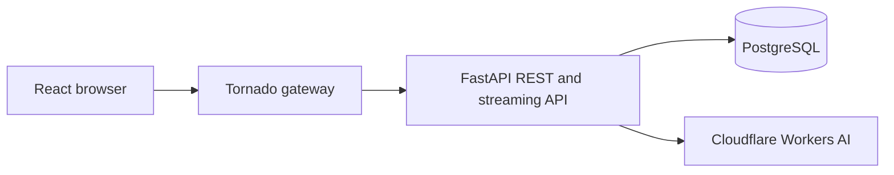

# Stova

A publishing workspace for turning a company's brand and up to ten topics into individual, branded articles. The interface follows an Oxford Navy and Ivory literary journal: serif headings, quiet rules, a topic command panel and a distraction-free editor.

**Live application:** [Open Stova](https://stova.174.129.245.156.sslip.io/). Register your own account to try the private workspace. [Read the sample publication](https://stova.174.129.245.156.sslip.io/blog/d6a04213-ed79-48aa-8fb0-6a60de2868ef) without signing in.

For the feature checklist, review sequence and verification notes, see [the submission guide](SUBMISSION.md).

## Stack

| Layer | Technology and responsibility |
| --- | --- |
| Frontend | React 19, TypeScript/JavaScript, HTML and CSS, built with Vite |
| Gateway | Python and Tornado; serves React, forwards REST requests and streams generation events |
| Application | Python and FastAPI; accounts, ownership, publications, articles, publishing and writing jobs |
| Persistence | PostgreSQL 17, SQLAlchemy async, asyncpg and Alembic migrations |
| Writing | Cloudflare Workers AI over HTTPS; shared owner connection with a daily reservation limit |
| Packaging | Docker multi-stage builds and Docker Compose |
| Delivery | Git and GitHub Actions; verification plus a manual AWS release workflow |
| Live hosting | AWS EC2 with Caddy HTTPS, a stable address, private S3 releases and SSM secrets; an optional CloudFront deployment is also supported |



Tornado is the actual streaming reverse proxy and static server. FastAPI runs privately behind it. A publication can contain 1–10 topics, and each ready article can be edited, downloaded as Markdown and published at `/blog/PUBLICATION_ID/ARTICLE_SLUG`. The collection is at `/blog/PUBLICATION_ID`.

## Run locally with Docker

Requires Docker with its Linux engine and Docker Compose. Copy `.env.example` to `.env`, then generate a random secret:

```sh
cp .env.example .env
python -c "import secrets; print(secrets.token_urlsafe(48))"
```

Put the printed value in `.env` as `JWT_SECRET`, then start the application:

```sh
docker compose up -d --build --wait
```

Open `http://127.0.0.1:8080` and register an account. PostgreSQL data stays in the `stova-postgres` Docker volume. `docker compose down` stops the application and preserves it; adding `-v` deletes that local database. Do not use the development password or HTTP cookie settings on a public host.

```sh
python scripts/smoke.py --base-url http://127.0.0.1:8080
```

The smoke check registers a disposable account, saves and publishes an explicit test article, checks its public page and removes its own test publication. It does not call a writing provider.

## Enable shared writing

Set these owner-controlled values in the ignored `.env`, then recreate the API container:

```dotenv
CLOUDFLARE_ACCOUNT_ID=your_account_id
CLOUDFLARE_API_TOKEN=your_workers_ai_token
CLOUDFLARE_AI_FREE_TIER_CONFIRMED=true
```

Only confirm the last setting for a Cloudflare Free account. Users of the site do not enter their own keys. Secrets stay on the server. An optional personal Groq connection is available through writing settings, but there is no automatic switch to a paid provider.

The shared service reserves 300 neurons before each attempt and stops at 9,000 per UTC day. Reservations are atomic in PostgreSQL across users and processes, are never refunded, and include a midnight guard. The pinned model is `@cf/qwen/qwen3-30b-a3b-fp8`, with bounded prompts and output. Drafts must contain 950–1,100 words; an invalid result gets one separately reserved revision. Provider errors leave a retryable draft instead of fabricated content. This application allowance cannot account for usage of the same Cloudflare account by other applications; keep the provider on its Free plan as the final no-paid-usage boundary.

## Development and verification

Use Python 3.12 and Node 22. Install the API, gateway and deployment test dependencies:

```sh
python -m venv .venv
# Activate .venv using your shell's normal command.
python -m pip install -e './backend[test]' -r gateway/requirements.txt boto3 cfn-lint
```

Set `DATABASE_URL`, `JWT_SECRET` and local cookie/origin values using `.env.example`. Start a PostgreSQL database. For migrations, also export `DATABASE_URL` into the process environment: Alembic does not load `.env` automatically. In Bash use `export DATABASE_URL='YOUR_POSTGRESQL_ASYNCPG_URL'`; in PowerShell use `$env:DATABASE_URL='YOUR_POSTGRESQL_ASYNCPG_URL'`. Then:

```sh
python -m alembic -c backend/alembic.ini upgrade head
python -m uvicorn app.main:app --app-dir backend --host 127.0.0.1 --port 8000
```

In separate terminals:

```sh
cd frontend
npm ci
npm run dev
```

Vite forwards `/api` to FastAPI. To preview the production frontend, run `npm run build` in `frontend`, then `python -m gateway.main` from the repository root.

For local Docker development, an ignored `compose.override.yaml` can mount `./backend/app` read-only at `/app/app` in the API service. Restart the API after Python edits with `docker compose restart api`; this avoids rebuilding dependencies for a source-only change. Verification and deployment continue to build the full image from the tracked Dockerfile.

Backend and importer integration tests require a **separate disposable PostgreSQL database** in `TEST_DATABASE_URL`; they reset its schema. Never point them at a development or production database containing data.

```sh
python -m pytest -c backend/pyproject.toml backend/tests tests -q --import-mode=importlib
python -m unittest discover -s infra/aws/tests -v
cfn-lint infra/aws/template.json infra/aws/template.direct.json
cd frontend
npm test
npm run build
```

The GitHub verification workflow runs these checks and builds the real containers, then exercises account creation, draft persistence and public publishing through Tornado.

## Accounts and API

Authentication uses a signed, expiring HttpOnly session cookie, scrypt password hashes and server-side session revocation. Each private request is scoped to its signed-in owner. JSON mutation requests have origin, content type and body-size checks. Public endpoints return only published content. Markdown is rendered with safe React nodes; embedded HTML is not executed.

Interactive REST documentation is available at `/api/docs` and the schema at `/api/openapi.json`. `/healthz` checks liveness and `/readyz` checks the database. Generation uses `text/event-stream` through Tornado, including cancellation cleanup and backpressure.

## Existing publication migration

The JSON importer preserves a version-1 publication backup in an already registered destination account:

```sh
python scripts/import_publications.py outputs/migration/publication-backup.json --owner-email YOUR_REGISTERED_EMAIL
```

Run `python scripts/import_publications.py --help` for exact options. The importer validates all fields first, preserves IDs, slugs, Markdown, branding and draft status, and writes in one transaction. It refuses collisions and never overwrites publications. An optional writing-budget carry only increases the destination reservation count. Backups belong in ignored `outputs/`, not Git. Stop writing on the previous host, refresh the backup and carry the current allowance immediately before a real cutover; a saved snapshot is not a live database sync. Activate the shared provider connection on the destination only after this handover so independent databases do not allocate the same daily allowance twice.

## AWS hosting

The reference application is deployed on AWS and was verified on 24 October 2026. The live path is Caddy HTTPS → Tornado → FastAPI → PostgreSQL on one EC2 instance. Caddy renews its public certificate automatically; the hostname uses a stable address and a free DNS service. S3 release artifacts are private, and runtime credentials are stored in SSM SecureString parameters. Accounts and published content were migrated with an exact eight-table data check and a retained recovery backup.

The deployment is intended for a portfolio or assignment demonstration. It uses a single PostgreSQL disk and is not a high-availability service. Availability also depends on the DNS service and the active hosting plan.

Creating or resuming a workload requires an authenticated owner account whose active AWS Free plan, remaining credits and expiry are verified by AWS. The default deployment command is read-only:

```sh
python scripts/aws_deploy.py plan --region us-east-1
```

The scripts refuse paid, expired, unknown or exhausted plans and have no paid-plan override. AWS Free hosting is credit-backed and time-limited; it is not permanently free. Keep backups and remove resources before upgrading the AWS account to a paid plan.

See [AWS setup, release, backup and teardown](infra/aws/README.md). The reference repository has its manual GitHub deployment workflow configured with an OIDC role, stack and region; no long-lived AWS access keys are stored in GitHub. A fresh copy needs its own account and workflow variables. Normal application updates use the `release` command, which preserves the database volume. Full `deploy` refuses infrastructure differences and must not be used to bypass a separate infrastructure review. Runtime provider credentials are supplied through encrypted SSM settings, never committed to the repository.
